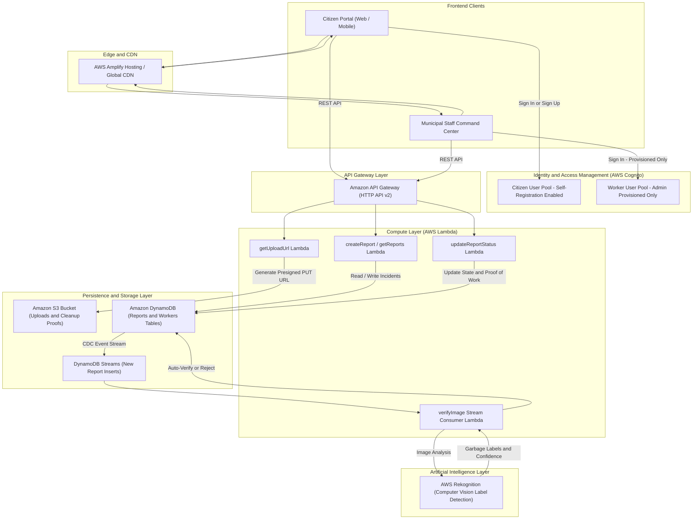
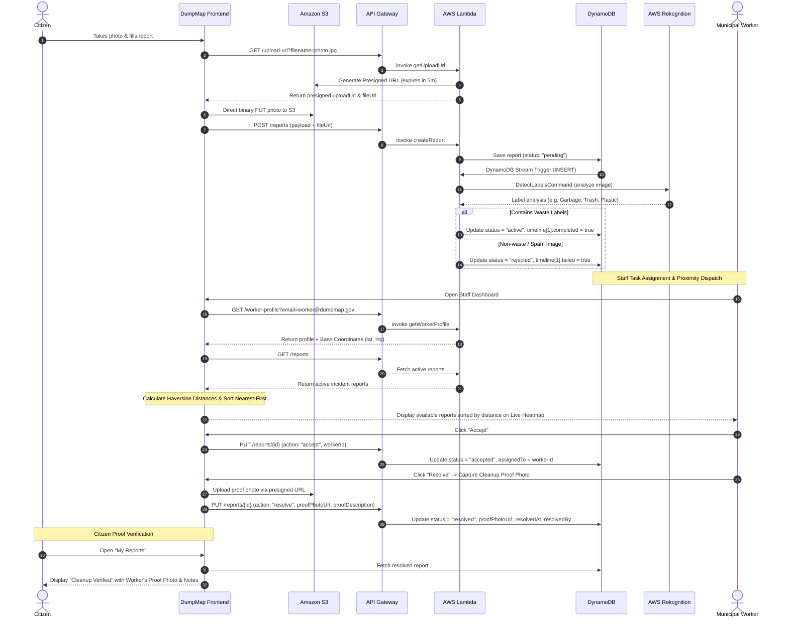
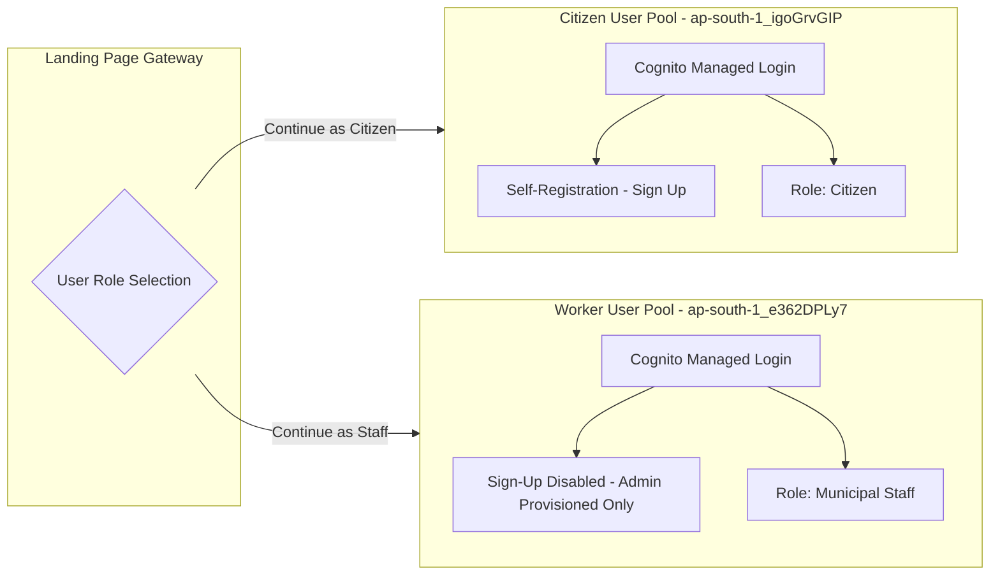

# DumpMap

> **An AI-Powered, Real-Time Municipal Waste Tracking, Verification & Resolution Platform.**

DumpMap connects citizens and municipal sanitation crews to eliminate illegal dumping, streamline civic cleanup operations, and verify waste remediation through automated computer vision and photographic proof-of-work.

[](https://main.d1alwwuxorewbc.amplifyapp.com/)
[](https://aws.amazon.com/)
[](https://vitejs.dev/)
[](https://aws.amazon.com/rekognition/)

---

## Table of Contents
- [System Architecture](#system-architecture)
- [Key Features](#key-features)
  - [1. Citizen Experience](#1-citizen-experience)
  - [2. Municipal Staff & Field Crew Experience](#2-municipal-staff--field-crew-experience)
  - [3. AI Verification & Triage](#3-ai-verification--triage)
- [Architecture & Workflow Diagrams](#architecture--workflow-diagrams)
  - [System Flow & Cloud Architecture](#system-flow--cloud-architecture)
  - [End-to-End Incident Lifecycle](#end-to-end-incident-lifecycle)
- [Tech Stack Details](#tech-stack-details)
- [Data Models & Schema](#data-models--schema)
  - [Reports Table (`dumpmap-backend-dev-reports`)](#reports-table)
  - [Workers Table (`dumpmap-backend-dev-workers`)](#workers-table)
- [API Reference](#api-reference)
- [Authentication Architecture (Dual Cognito Pools)](#authentication-architecture-dual-cognito-pools)
- [Deployment Guide](#deployment-guide)
  - [Deploying the Serverless Backend](#deploying-the-serverless-backend)
  - [Deploying the Frontend to AWS Amplify](#deploying-the-frontend-to-aws-amplify)
- [Local Development Setup](#local-development-setup)
- [License](#license)

---

## System Architecture

DumpMap employs a cloud-native, 100% serverless event-driven architecture designed for high availability, zero idle cost, and horizontal scalability.



---

## Key Features

### 1. Citizen Experience
- **Modernized Civic Portal**: High-aesthetic, responsive landing experience prioritizing public citizen reporting with immediate status tracking.
- **Interactive 5-Step Waste Reporting**: Mobile-optimized flow to document location, waste category (plastic, wet, hazardous, debris), amount, urgency flags, and photographic evidence.
- **Precision Geolocation**: Built on Leaflet and OpenStreetMap with interactive reverse-geocoded map pinning and coordinate tracking.
- **Live Status Timeline**: Transparent tracking displaying incident milestones: `Reported` -> `Verified` -> `Accepted by Crew` -> `Resolved`.
- **Proof-of-Work Verification**: Once a municipal crew resolves the task, citizens can view the **Worker's Proof of Cleanup Photo**, worker notes, resolution timestamp, and service crew attribution directly in their card details.

### 2. Municipal Staff & Field Crew Experience
- **Role-Based Provisioned Access**: Field staff log in through a separate, hardened Cognito pool with pre-provisioned municipal accounts (`worker1@dumpmap.gov`, `worker2@dumpmap.gov`, etc.) without public signup exposure.
- **Crew Profile & Location Resolution**: When crew members sign in with email and password, their full profile (Name, Worker ID, Zone, and Assigned Base Address) is fetched from the municipal registry. Coordinates are stored in the backend as latitude and longitude, and resolved into human-readable Delhi addresses on the frontend.
- **Proximity-Based Task Dispatching (Distance Sorting)**: Reports in the Staff Task Manager are automatically sorted by proximity to the crew's assigned base address ($X$) using the Haversine formula (**nearest reports first, farthest reports last**). Each report card displays an exact proximity badge (e.g., `📍 331 m away`, `📍 1.4 km away`).
- **Live Interactive Heatmap**: Displays 40+ active, AI-verified hotspots across Delhi categorized into High (🔴 Red), Medium (🟡 Yellow), and Low (🔵 Blue) criticality, complete with the crew's base location marker and popup distance metrics.
- **Task Assignment Matrix**: Real-time tabs categorizing tasks into:
  - **Available**: Unclaimed, verified civic reports sorted by distance from base.
  - **My Accepted**: Active dispatch assignments claimed by the logged-in staff member.
  - **My Resolved**: Completed cleanups with stored resolution history.
- **Isolated Incident Location Map**: When inspecting incident details, an embedded map isolates only that specific report with immediate Google Maps turn-by-turn navigation links.
- **Mandatory Proof-of-Work Submission**: When clicking **Resolve**, a popup requires the crew to capture or upload an on-site photo confirming the area was cleared, along with optional cleanup remarks (e.g., *"Cleared 3 bags of plastic bottles and disinfected the curb"*).

### 3. AI Verification & Triage
- **Automated Anti-Spam Pipeline**: Every submitted report triggers asynchronous Computer Vision analysis via AWS Rekognition.
- **Garbage & Hazard Recognition**: Scans for labels such as *Trash, Garbage, Rubble, Waste, Pollution, Litter, Plastic, Landfill*.
- **Instant Filtering**: Irrelevant submissions (e.g. selfies, random landscapes, pet photos) are automatically flagged as `rejected` and kept off dispatch queues.

---

## Architecture & Workflow Diagrams

### System Flow & Cloud Architecture



---

## Tech Stack Details

| Layer | Technologies | Purpose |
| :--- | :--- | :--- |
| **Frontend Framework** | React 19, Vite 8 | Ultra-fast client-side SPA rendering |
| **Mapping Engine** | Leaflet, React-Leaflet | OpenStreetMap tiles, custom marker clustering, coordinate centering |
| **Authentication** | AWS Cognito, `oidc-client-ts`, `react-oidc-context` | PKCE Authorization Code flow with Managed Login v2 UI |
| **Styling & Design** | Vanilla CSS (Glassmorphism, CSS Variables) | Premium dark/light themes, responsive layout, fluid animations |
| **Cloud Hosting** | AWS Amplify Hosting | Continuous deployment via GitHub, global CDN edge caching, SPA routing |
| **API Management** | Amazon API Gateway (HTTP API v2) | Low-latency routing and CORS proxying to Lambda |
| **Serverless Compute**| AWS Lambda (Node.js 20) | On-demand microservices for reports, uploads, and resolution status |
| **Database** | Amazon DynamoDB | Single-digit millisecond NoSQL storage with Streams enabled |
| **Storage** | Amazon S3 | Secure private storage with short-lived presigned PUT URLs |
| **AI / Machine Learning** | AWS Rekognition | Serverless computer vision and deep learning label detection |
| **Infrastructure as Code**| Serverless Framework (`serverless.yml`) | Reproducible multi-resource AWS stack provisioning |

---

## Data Models & Schema

### Reports Table
`dumpmap-backend-dev-reports` &bull; **Partition Key:** `id` (String / UUID)

```json
{
  "id": "e4b2d308-4171-460d-9a67-d8c7c9ba2f99",
  "userId": "11830dca-10d1-70f9-3cb9-994471945423",
  "location": "Connaught Place, Block B, New Delhi",
  "lat": "28.6315",
  "lng": "77.2167",
  "type": "plastic",
  "amount": "medium",
  "criticality": "high",
  "severity": ["blocking_path", "near_water"],
  "description": "Large accumulation of plastic bags and bottles blocking pedestrian drainage.",
  "photoUrl": "https://dumpmap-backend-dev-uploads-984844735243.s3.amazonaws.com/uploads/guid-photo.jpg",
  "status": "resolved",
  "assignedTo": "worker1@dumpmap.gov",
  "resolvedAt": "2026-10-11T04:48:33.123Z",
  "resolvedBy": "Ramesh Kumar",
  "proofPhotoUrl": "https://dumpmap-backend-dev-uploads-984844735243.s3.amazonaws.com/uploads/guid-proof-1791689123.jpg",
  "proofDescription": "Cleared 4 bags of plastic waste, swept pathway, and disinfected drainage grate.",
  "timeline": [
    { "status": "Reported", "completed": true, "timestamp": "2026-10-11T02:10:00.000Z" },
    { "status": "Verified", "completed": true, "timestamp": "2026-10-11T02:10:05.120Z" },
    { "status": "Accepted", "completed": true, "timestamp": "2026-10-11T03:30:15.000Z" },
    { "status": "Resolved", "completed": true, "timestamp": "2026-10-11T04:48:33.123Z" }
  ],
  "createdAt": "2026-10-11T02:10:00.000Z"
}
```

### Workers Table
`dumpmap-backend-dev-workers` &bull; **Partition Key:** `email` (String)

```json
{
  "email": "worker1@dumpmap.gov",
  "name": "Ramesh Kumar",
  "workerId": "STAFF-001",
  "zone": "North Delhi",
  "latitude": 28.7041,
  "longitude": 77.1025,
  "role": "staff"
}
```

> **Note on Geospatial Representation:** On the backend and database, crew base locations are stored as numeric `latitude` and `longitude` coordinates for rapid Euclidean/Haversine distance computations. On the frontend, these coordinates are reverse-geocoded and presented as localized Delhi street addresses in words (e.g., *"Sector 14, Rohini, North Delhi, Delhi 110085"*).

---

## API Reference

**Base URL:** `https://9y9e6wstgh.execute-api.us-east-1.amazonaws.com`

| Method | Endpoint | Description | Sample Body / Query |
| :--- | :--- | :--- | :--- |
| `GET` | `/upload-url` | Generates a 5-minute pre-signed S3 PUT URL | `?filename=photo.jpg&filetype=image/jpeg` |
| `POST` | `/reports` | Creates a new report and queues image verification | `{ location, lat, lng, type, amount, criticality, description, photoUrl, userId }` |
| `GET` | `/reports` | Retrieves reports (all active, or filtered by citizen) | `?userId={sub}` |
| `PUT` | `/reports/{id}` | Updates task assignment or marks as resolved with proof | `{ action: "resolve", userId, workerName, proofPhotoUrl, proofDescription }` |
| `GET` | `/worker-profile` | Retrieves crew profile with coordinates by email | `?email=worker1@dumpmap.gov` |
| `POST` | `/verify-worker` | Direct credential verification fallback | `{ email, password }` |

---

## Authentication Architecture (Dual Cognito Pools)

DumpMap strictly separates public citizen accounts from municipal authority credentials:



- **Citizen Pool (`ap-south-1_igoGrvGIP`)**: Public user registration enabled with email verification.
- **Staff Pool (`ap-south-1_e362DPLy7`)**: `AllowAdminCreateUserOnly: true`. Protects government dispatch tools from unauthorized public registration. Accounts are provisioned via `seed-workers.js`.
- **Cognito Logout Handling**: Features custom parameter sanitization (`signOutCognito`) to prevent Cognito Managed Login v2 HTTP 400 parameter errors.

---

## Deployment Guide

### Deploying the Serverless Backend
1. Clone the repository:
   ```bash
   git clone https://github.com/MAHanupriSAR/DumpMap.git
   cd DumpMap/backend
   ```
2. Install dependencies:
   ```bash
   npm install
   ```
3. Deploy to your AWS account:
   ```bash
   npx serverless deploy
   ```
4. Seed authorized municipal staff into DynamoDB:
   ```bash
   node seed-workers.js
   ```

### Deploying the Frontend to AWS Amplify
1. Open the AWS Amplify Console.
2. Click **Deploy an app** -> select **GitHub** -> select repository `MAHanupriSAR/DumpMap` and branch `main`.
3. Accept the default build settings:
   - Build command: `npm run build`
   - Output directory: `dist`
4. Confirm SPA rewrite rules under **Rewrites and redirects**:
   - Source: `/<*>`
   - Target: `/index.html`
   - Status: `404-200`
5. Click **Save and Deploy**.
6. **Whitelist the new domain in Cognito**:
   ```powershell
   $DOMAIN = "https://your-app-id.amplifyapp.com"

   # Whitelist on Citizen Pool
   aws cognito-idp update-user-pool-client --user-pool-id ap-south-1_igoGrvGIP --client-id 55dht6jg5ta3c3heobhneh5na8 --allowed-o-auth-scopes email openid phone profile --allowed-o-auth-flows code --allowed-o-auth-flows-user-pool-client --callback-urls "http://localhost:5173" "$DOMAIN" --logout-urls "http://localhost:5173" "$DOMAIN" --supported-identity-providers COGNITO --region ap-south-1

   # Whitelist on Staff Pool
   aws cognito-idp update-user-pool-client --user-pool-id ap-south-1_e362DPLy7 --client-id 40k8du3o5djge7mbasnftrcm7m --allowed-o-auth-scopes email openid phone profile --allowed-o-auth-flows code --allowed-o-auth-flows-user-pool-client --callback-urls "http://localhost:5173" "$DOMAIN" --logout-urls "http://localhost:5173" "$DOMAIN" --supported-identity-providers COGNITO --region ap-south-1
   ```

---

## Local Development Setup

### Prerequisites
- Node.js 18+
- AWS CLI configured with active credentials

### Installation
```bash
# Clone repository
git clone https://github.com/MAHanupriSAR/DumpMap.git
cd DumpMap

# Install frontend dependencies
npm install

# Start local Vite development server
npm run dev
```

Open `http://localhost:5173` in your browser.

---

## License
This project is open-source and licensed under the [MIT License](LICENSE).
